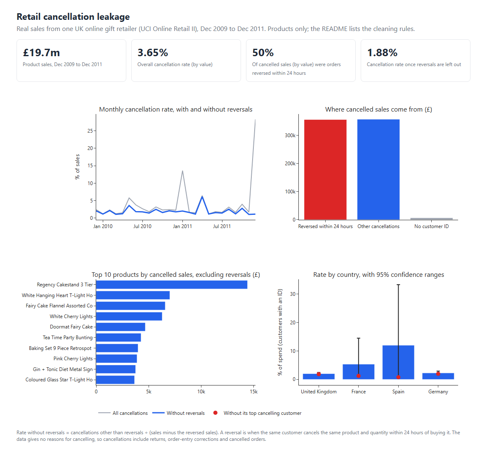
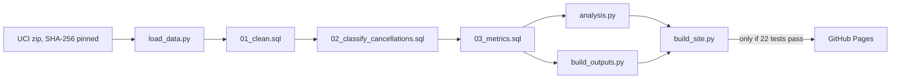

# Retail Cancellation Leakage: separating order-entry reversals from real cancellations

[](https://github.com/Anubhavkumarkanth/retail-cancellation-leakage/actions/workflows/tests.yml)

An SQL + Python analysis of two years of transactions from a UK online gift-ware retailer (UCI *Online Retail II*, 1.07 million raw rows).
**Business question:** how much revenue is lost to cancellations, where does it come from, and which of it can the business actually act on?

**Live dashboard:** _link added only after the GitHub Pages deployment is verified._ · **Power BI report:** _added after the report is built and checked._



## Findings

All figures are reproduced by `python run_all.py` and checked by `pytest` (see [Validation](#validation)). Values are GBP.

| # | Finding | Evidence |
|---|---------|----------|
| 1 | The headline cancellation rate is **3.65%** (£719,656 of £19.70m gross sales), but **49.5% of the cancelled value is same-day reversals**. After removing them the rate is **1.88%**. | `outputs/csv/kpi_overview.csv` |
| 2 | Two orders explain the two biggest monthly spikes: 80,995 units of one SKU (£168k, Dec 2011) and 74,215 units of another (£77k, Jan 2011). Each was placed and cancelled within 16 minutes. Together they are 34% of all cancelled value. The first SKU has no other sale line at all, the second SKU's next-largest line is 288 units, and 99.9% of all sale lines are 500 units or fewer. Dec 2011 falls from 28.3% to 1.15% and Jan 2011 from 13.6% to 2.0% once reversals are separated. | `reports/figures/01_monthly_headline_vs_adjusted.png` |
| 3 | The remaining genuine spike is April 2011 (6.1% adjusted): 72.7% of that month's non-reversal cancelled value is one customer (£23k). | `outputs/csv/high_rate_months.csv` |
| 4 | Cancelled value is concentrated in a few products: the top 5% of SKUs (of 2,746) hold 53.1% of non-reversal cancelled value; the top 20% hold 80.6%. Regency Cakestand 3 Tier is the largest at £14.4k (4.4% of its sales). Several small lines have very high rates, for example White Cherry Lights 34.9% and Small Fairy Cake Fridge Magnets 53.0%, on only £7k to £18k of sales. | `outputs/csv/sku_top_cancelled.csv` |
| 5 | Country differences are not reliable. Spain's 12.0% and France's 5.3% each rest on one customer (94.5% and 78.2% of that country's cancelled value). Without that customer they are 0.8% and 1.2%. The 95% bootstrap intervals (0.5% to 33.3% and 0.9% to 14.5%) overlap the UK's 2.0% (1.7% to 2.5%). | `outputs/csv/country_bootstrap.csv` |
| 6 | Cancelling is not a "bad customer" trait. 60% of identified customers have no non-reversal cancellation, but those who do cancel about 2.6% to 2.7% of what they spent whether they cancelled once, 2 to 4 times, or 5+ times. The 355 customers with 5+ cancellation invoices spend £6.0m and account for 46% of non-reversal cancelled value, close to their 45% share of spend among customers who cancelled. | `outputs/csv/customer_cancel_frequency.csv` |
| 7 | Among 5,852 identified customers the overall rate is 2.08% (95% CI 1.72% to 2.53%, customer-clustered bootstrap, 2,000 resamples). The top 1% of cancelling customers hold 35.9% of cancelled value, the top 10% hold 69.7%. | `outputs/findings.json` |

## Recommendations

Each one is tied to a finding above. None of the savings is quantified, because the data has no cancellation reasons or margins.

1. **Report two KPIs, not one.** Track same-day reversals (order-entry quality) separately from later cancellations (customer or fulfilment issues). The blended 3.65% overstates the problem by roughly a factor of two and made two single orders look like a crisis (findings 1, 2).
2. **Add an order-quantity sanity check at entry.** Both reversed orders were far larger than any other line on those SKUs and were cancelled within minutes. A confirmation prompt above a per-SKU threshold would have flagged them (finding 2). Whether the check is worth building depends on how often this happens; the data shows twice in two years.
3. **Investigate the handful of SKUs with 20%+ cancellation rates** (cherry lights, fairy-cake flannel and fridge magnets) before spending effort on the high-volume SKUs, whose rates are roughly 3% to 6% (finding 4). The data cannot say why customers cancelled; listing accuracy, packaging damage and stock-outs are hypotheses to check, not conclusions.
4. **Do not run a "serial canceller" programme.** Rates are flat across cancellation-frequency bands, so frequent cancellers are simply large customers (finding 6).
5. **Do not act on country differences yet.** Spain and France reflect one account each (finding 5). A single account manager conversation with those two customers would answer more than any country-level policy.

## Method

1. **Data.** UCI Online Retail II, CC BY 4.0, https://archive.ics.uci.edu/dataset/502/online+retail+ii. Real transactions, not synthetic. The download is verified against a SHA-256 hash in `scripts/download_data.py`.
2. **Load.** `src/load_data.py` stores both workbook sheets unmodified in SQLite (`raw_transactions`).
3. **Clean** (`sql/01_clean.sql`). Every rule comes from profiling the raw table:

   | Raw rows | Fate | Why |
   |---------:|------|-----|
   | 22,523 | Dropped as duplicates | The two workbook sheets overlap on 1 to 9 Dec 2010; each invoice is kept once, from the first sheet |
   | 6,029 | Dropped, price <= 0 | Stock write-offs and bad-debt adjustments, not trading |
   | 5,901 | Dropped, non-product code | POST, DOT, M, D, BANK CHARGES, AMAZONFEE, gift vouchers, test codes |
   | 1,032,918 | Kept | 1,014,945 sale lines and 17,973 cancellation lines |

   Kept lines are product lines on invoices that are either normal sales or `C`-prefixed cancellations with negative quantity.
4. **Classify cancellations** (`sql/02_classify_cancellations.sql`). A cancellation is a **same-day reversal** if the same customer bought the same SKU with exactly the opposite quantity at most 24 hours earlier. Everything else is "other"; cancellations with no customer ID cannot be matched.
5. **Metrics** (`sql/03_metrics.sql`): KPIs, monthly, country, SKU, SKU concentration, customer frequency bands. Window functions and CTEs are used for the concentration and ranking queries.
6. **Statistics** (`src/analysis.py`): customer-clustered bootstrap confidence intervals (customers, not lines, are resampled because a customer's lines are not independent), leave-one-customer-out checks, concentration shares. Random seed is fixed.
7. **Outputs:** HTML dashboard (`reports/dashboard.html`, Plotly), Excel summary (`outputs/cancellation_summary.xlsx`), five PNG figures (`reports/figures/`), CSVs (`outputs/csv/`).

**Definitions.** *Headline rate* = all cancelled value / gross sales value. *Adjusted rate* = (non-reversal cancelled value) / (gross sales minus reversed sales value). Reversed sales value is approximated by the reversal's cancelled value (same quantity, same customer and SKU; price can differ slightly).

## Run it

Python 3.10+ (developed on 3.12). First run takes about two minutes because the 45 MB Excel workbook is slow to read.

```bash
git clone https://github.com/Anubhavkumarkanth/retail-cancellation-leakage.git
cd retail-cancellation-leakage
python -m venv .venv && source .venv/bin/activate     # Windows: .venv\Scripts\activate
pip install -r requirements.txt
python run_all.py          # download -> load -> SQL -> analysis -> dashboard + workbook
pytest -q                  # 22 tests
```

Optional, to regenerate the dashboard screenshot: `pip install playwright && playwright install chromium && python scripts/screenshot_dashboard.py`.

## How it is published

`.github/workflows/pages.yml` downloads the original UCI file (checked against its SHA-256), runs `python run_all.py`, runs all 22 tests, builds the landing page with `scripts/build_site.py`, and deploys to GitHub Pages only if every step passed. A failed run leaves the last good site online.



## Validation

`pytest -q` runs 22 checks: 9 SQL logic, 7 real-data and 6 star-schema tests. The release candidate passed all 22 locally; the Pages workflow will rerun them after rebuilding the database:

- **SQL logic on a hand-built dataset** (`tests/test_sql_logic.py`, 9 tests): sheet-overlap dedupe, exclusion of non-product, zero-price and adjustment rows, `line_value` arithmetic, reversal classification, the two negative cases (quantity mismatch and cancellation before sale must not count as reversals), and the 24-hour boundary (23 h 59 min and exactly 24 h are reversals; 24 h 1 min is not). These also run in CI.
- **Reconciliation on the real data** (`tests/test_real_data.py`, 7 tests): every raw row is accounted for; sale and cancellation totals match an independent pandas re-implementation of the cleaning to 1e-9; classes sum to the cancelled total; no invalid values survive cleaning; overlap invoices are kept once; the KPI table is internally consistent. These are skipped automatically if `data/retail.db` has not been built.
- **Power BI star schema** (`tests/test_star_schema.py`, 6 tests): exported table counts, keys, customer ID types, reconciliation and DAX KPI arithmetic.

## Limitations

- **No cancellation reason and no link to the original invoice.** "Cancellation" mixes customer returns, order-entry corrections and cancelled orders. The reversal rule is a heuristic: it can miss a reversal that happened after 24 hours or with a different quantity, and it could label a genuine same-day return as a reversal.
- **22% of sale lines (13% of sale value) have no customer ID** (guest or unrecorded checkouts), and only 332 cancellation lines are in that group. Customer-level figures (findings 5 to 7) cover identified customers only; their rate (2.08%) differs slightly from the all-sales adjusted rate (1.88%).
- One retailer, December 2009 to December 2011, nominal GBP. Findings describe this business in that period, not retail in general.
- Cancelled value is revenue at list price on the invoice, not margin; nothing here estimates profit impact or savings.
- Customer country is taken as the country on the customer's lines; a few customers appear under more than one country.
- No `.pbix` is included yet. The repository provides a Power BI guide and star-schema CSV exporter; the Plotly dashboard and Excel workbook are available now.
- The raw workbook and the SQLite database are not committed (45 MB and about 300 MB); `run_all.py` rebuilds them.

## Layout

```
sql/        01_clean.sql  02_classify_cancellations.sql  03_metrics.sql
src/        load_data.py  run_sql.py  analysis.py  build_outputs.py
scripts/    download_data.py  screenshot_dashboard.py  build_site.py  site_template.html  export_star_schema.py
tests/      test_sql_logic.py  test_real_data.py  test_star_schema.py
outputs/    csv/ (query results)  findings.json  cancellation_summary.xlsx
reports/    dashboard.html  dashboard_screenshot.png  figures/
docs/       powerbi-guide.md
.github/    workflows/ (tests.yml, pages.yml)
```

Dataset: Chen, D. (2012). Online Retail II [Dataset]. UCI Machine Learning Repository. CC BY 4.0. Code: MIT.
