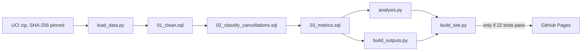

# Retail Cancellation Leakage: separating quick reversals from real cancellations

[](https://github.com/Anubhavkumarkanth/retail-cancellation-leakage/actions/workflows/tests.yml)

An SQL and Python analysis of two years of real sales from a UK online gift retailer (UCI *Online Retail II*, 1.07 million raw rows).
**The question:** how much sales value is lost to cancellations, where does it come from, and how much of it can the business actually do something about?

**Short answer:** about half of the cancelled value is orders reversed within 24 hours (same customer, same product, same quantity). Counted separately, the cancellation rate falls from 3.65% to 1.88%.

**Live dashboard:** [Open the published dashboard](https://anubhavkumarkanth.github.io/retail-cancellation-leakage/). · **Power BI:** _no report file yet; a build guide and a data export script are included._


## Findings

Every figure is rebuilt from the raw data by `python run_all.py` and checked by automated tests (see [Validation](#validation)). Money is in GBP (£).

| # | Finding | Evidence |
|---|---------|----------|
| 1 | Cancellations come to **3.65%** of sales (£719,656 of £19.70m). But **49.5% of that cancelled value is same-day reversals**: the same customer cancelling the same product and quantity within 24 hours of buying it. Leave those out and the rate is **1.88%**. | `outputs/csv/kpi_overview.csv` |
| 2 | Two single orders cause the two biggest monthly spikes: 80,995 units of one product (£168k, Dec 2011) and 74,215 units of another (£77k, Jan 2011). Each was placed and cancelled within 16 minutes, and together they are 34% of all cancelled value. Both were far out of line: the first product has no other sale at all, the second product's next-largest sale is 288 units, and 99.9% of all sale lines are 500 units or fewer. Without reversals, Dec 2011 drops from 28.3% to 1.15% and Jan 2011 from 13.6% to 2.0%. | `reports/figures/01_monthly_headline_vs_adjusted.png` |
| 3 | The one real spike left is April 2011 (6.1% without reversals), and 72.7% of that month's remaining cancelled value comes from one customer (£23k). | `outputs/csv/high_rate_months.csv` |
| 4 | A few products account for most cancellations. Of the 2,746 products with cancellations other than reversals, the top 5% hold 53.1% of that cancelled value and the top 20% hold 80.6%. The largest is Regency Cakestand 3 Tier at £14.4k (4.4% of its sales). Some small products have very high rates, for example White Cherry Lights at 34.9% and Small Fairy Cake Fridge Magnets at 53.0%, on only £7k to £18k of sales. | `outputs/csv/sku_top_cancelled.csv` |
| 5 | Country differences are not reliable. Spain's 12.0% and France's 5.3% each come down to one customer (94.5% and 78.2% of that country's cancelled value). Without that customer they are 0.8% and 1.2%. Their 95% confidence ranges (0.5% to 33.3% and 0.9% to 14.5%) overlap the UK's 2.0% (1.7% to 2.5%). | `outputs/csv/country_bootstrap.csv` |
| 6 | Frequent cancellers are not "bad customers". 60% of identified customers never cancel apart from reversals. Those who do cancel about 2.6% to 2.7% of what they spend, whether they cancelled once, 2 to 4 times, or 5 or more times. The 355 customers who cancelled 5 or more times spend £6.0m and account for 46% of the cancelled value (excluding reversals), close to their 45% share of spending among customers who cancel. | `outputs/csv/customer_cancel_frequency.csv` |
| 7 | Across 5,852 identified customers the overall rate is 2.08%, with a 95% confidence range of 1.72% to 2.53% (a bootstrap that resamples whole customers 2,000 times). The top 1% of cancelling customers hold 35.9% of cancelled value, and the top 10% hold 69.7%. | `outputs/findings.json` |

## Recommendations

Each one links back to a finding above. None comes with a savings estimate, because the data has no cancellation reasons or profit margins.

1. **Report two numbers, not one.** Track same-day reversals (a sign of order-entry quality) separately from other cancellations (customer or fulfilment problems). The combined 3.65% makes the problem look about twice as big as it is, and it made two single orders look like a crisis (findings 1, 2).
2. **Add a quantity check when orders are entered.** Both reversed orders were far larger than any other sale of those products and were cancelled within minutes. An "are you sure?" prompt above a set quantity for each product would have caught them (finding 2). Whether that is worth building depends on how often it happens; the data shows it twice in two years.
3. **Look first at the few products with cancellation rates above 20%** (cherry lights, fairy-cake flannel and fridge magnets), before the big sellers, whose rates are roughly 3% to 6% (finding 4). The data cannot say why customers cancelled. Wrong listings, damaged packaging and items running out of stock are ideas to check, not conclusions.
4. **Don't single out "serial cancellers".** Customers cancel about the same share of what they spend however often they cancel, so frequent cancellers are simply big customers (finding 6).
5. **Don't act on country differences yet.** Spain and France each reflect one customer account (finding 5). Talking to those two customers would answer more than any country-wide policy.

## Method

1. **Data.** UCI Online Retail II, CC BY 4.0, https://archive.ics.uci.edu/dataset/502/online+retail+ii. Real transactions, not synthetic. The download is checked against a fixed SHA-256 fingerprint in `scripts/download_data.py`, so a changed file is caught.
2. **Load.** `src/load_data.py` copies both workbook sheets into a SQLite database unchanged (`raw_transactions`).
3. **Clean** (`sql/01_clean.sql`). Every rule comes from first examining the raw table:

   | Raw rows | What happens | Why |
   |---------:|------|-----|
   | 22,523 | Dropped as duplicates | The two workbook sheets overlap on 1 to 9 Dec 2010; each invoice is kept once, from the first sheet |
   | 6,029 | Dropped, price zero or below | Stock write-offs and bad-debt adjustments, not real sales |
   | 5,901 | Dropped, not a product | Postage, bank charges, Amazon fees, gift vouchers and test codes (POST, DOT, M, D, BANK CHARGES, AMAZONFEE) |
   | 1,032,918 | Kept | 1,014,945 sale lines and 17,973 cancellation lines |

   What remains are product lines from normal sales, plus cancellations (invoice numbers starting with `C`, with a negative quantity).
4. **Classify cancellations** (`sql/02_classify_cancellations.sql`). A cancellation counts as a **same-day reversal** if the same customer bought the same product, in exactly the opposite quantity, at most 24 hours earlier. Everything else is "other". Cancellations with no customer ID cannot be matched.
5. **Metrics** (`sql/03_metrics.sql`): the headline numbers, plus breakdowns by month, country and product, how concentrated cancellations are, and how often customers cancel. The concentration and ranking queries use CTEs and window functions.
6. **Statistics** (`src/analysis.py`): 95% confidence ranges from a bootstrap. Whole customers are resampled rather than single lines, because one customer's lines are not independent of each other. Also leave-one-customer-out checks and concentration shares. The random seed is fixed, so every run gives the same numbers.
7. **Outputs:** an interactive HTML dashboard (`reports/dashboard.html`, Plotly), an Excel summary (`outputs/cancellation_summary.xlsx`), five charts (`reports/figures/`) and CSV query results (`outputs/csv/`).

**Definitions.** *Headline rate* = all cancelled value ÷ gross sales. *Adjusted rate* = cancelled value excluding reversals ÷ (gross sales minus the reversed sales). Reversed sales are approximated by the reversal's cancelled value (same quantity, customer and product; the price can differ slightly).

## Run it

Python 3.10+ (developed on 3.12). The first run takes about two minutes because the 45 MB Excel workbook is slow to read.

```bash
git clone https://github.com/Anubhavkumarkanth/retail-cancellation-leakage.git
cd retail-cancellation-leakage
python -m venv .venv && source .venv/bin/activate     # Windows: .venv\Scripts\activate
pip install -r requirements.txt
python run_all.py          # download -> load -> SQL -> analysis -> dashboard + workbook
pytest -q                  # 22 tests
```

Optional, to regenerate the dashboard screenshot: `pip install playwright && playwright install chromium && python scripts/screenshot_dashboard.py`.

## How it is published

On every push to `main`, `.github/workflows/pages.yml` downloads the original UCI file (checked against its SHA-256 fingerprint), rebuilds everything with `python run_all.py`, runs all 22 tests, builds the landing page with `scripts/build_site.py`, and publishes to GitHub Pages only if every step passed. If a run fails, the last good site stays online.



## Validation

`pytest -q` runs 22 tests: 9 on the SQL logic, 7 on the real data and 6 on the Power BI export. The Pages workflow runs all 22 before every deploy, and the site is published only if they pass.

- **SQL logic on a small hand-built dataset** (`tests/test_sql_logic.py`, 9 tests): removing the sheet overlap; excluding non-product, zero-price and adjustment rows; line value arithmetic; reversal classification; two cases that must not count as reversals (a quantity mismatch, and a cancellation before the sale); and the 24-hour boundary (23 h 59 min and exactly 24 h count as reversals; 24 h 1 min does not). These also run on every push and pull request.
- **Checks on the real data** (`tests/test_real_data.py`, 7 tests): every raw row is accounted for; sale and cancellation totals match a separate pandas version of the cleaning to within 1e-9; the categories add up to the cancelled total; no invalid values survive cleaning; overlapping invoices are kept once; the summary table is internally consistent. These skip themselves if `data/retail.db` has not been built.
- **Power BI export** (`tests/test_star_schema.py`, 6 tests): the exported star-schema tables have the right row counts, keys and customer ID types, they reconcile with the totals, and the DAX measure arithmetic reproduces the headline figures.

## Limitations

- **No cancellation reasons, and no link back to the original invoice.** "Cancellation" mixes customer returns, order-entry corrections and cancelled orders. The reversal rule is a rule of thumb: it can miss a reversal made after 24 hours or for a different quantity, and it could label a genuine same-day return as a reversal.
- **22% of sale lines (13% of sales value) have no customer ID** (guest or unrecorded checkouts), and only 332 cancellation lines are in that group. Customer-level figures (findings 5 to 7) cover identified customers only; their rate (2.08%) differs slightly from the all-sales adjusted rate (1.88%).
- One retailer, December 2009 to December 2011, in pounds not adjusted for inflation. The findings describe this business in that period, not retail in general.
- Cancelled value is the price on the invoice, not profit; nothing here estimates lost profit or savings.
- A customer's country is the country on their order lines; a few customers appear under more than one country.
- There is no Power BI report file (`.pbix`) yet. The repository has a build guide and a script that exports the data for Power BI; the interactive dashboard and Excel workbook are available now.
- The raw workbook and the SQLite database are not committed (45 MB and about 300 MB); `run_all.py` rebuilds them.

## Layout

```
sql/        01_clean.sql  02_classify_cancellations.sql  03_metrics.sql
src/        load_data.py  run_sql.py  analysis.py  build_outputs.py
scripts/    download_data.py  screenshot_dashboard.py  build_site.py  site_template.html  export_star_schema.py
tests/      test_sql_logic.py  test_real_data.py  test_star_schema.py
outputs/    csv/ (query results)  findings.json  cancellation_summary.xlsx
reports/    dashboard.html  dashboard_screenshot.png  figures/
docs/       powerbi-guide.md
.github/    workflows/ (tests.yml, pages.yml)
```

Dataset: Chen, D. (2012). Online Retail II [Dataset]. UCI Machine Learning Repository. CC BY 4.0. Code: MIT.
